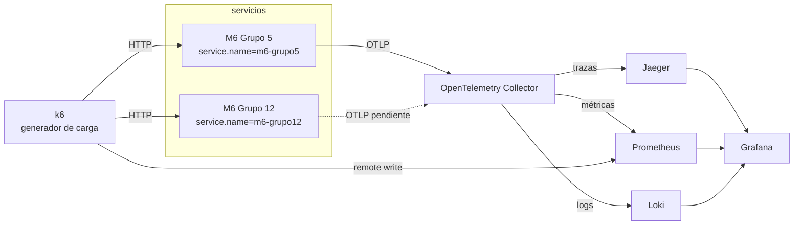

# Arquitectura de M6 y sus integraciones

El diagrama de integraciones, el estado de cada una y la comparativa entre las dos implementaciones
(Grupo 5 y Grupo 12) están en **[relevamiento/README.md](relevamiento/README.md)**.

## Telemetría (lo que armamos nosotros)

Stack local en [`observabilidad/`](../observabilidad/) (docker compose). Dashboard en [`dashboards/`](../dashboards/).
