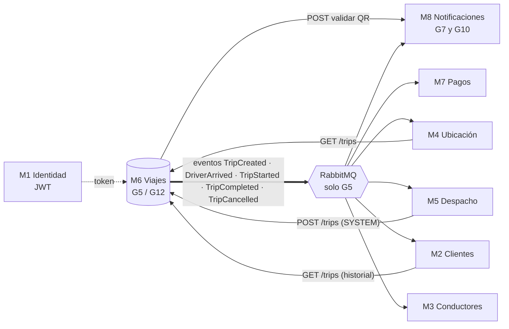

# Relevamiento de M6 · Viajes y Ciclo de Vida

Fecha del relevamiento: 2026-11-13 · Realizado sobre los repos clonados localmente.
Documentos por grupo: [Grupo 5](grupo5.md) · [Grupo 12](grupo12.md)

> **Cómo leerlo.** Cada dato sale del código o de los documentos de los repos (se indica de dónde).
> Lo que **no pudimos verificar** está marcado como _[a confirmar]_ y se repite en
> [Preguntas abiertas](#preguntas-abiertas-para-llevar-a-las-reuniones).
> Los repos relevados están en estos commits: G5 `7e96af7` (main, 2026-11-11) · G12 `e0755a4` (`m6/base-de-datos`, 2026-11-12).

## 1. Qué es M6 y quién lo implementa

M6 gestiona la máquina de estados de un viaje: `PENDING_ARRIVAL → DRIVER_ARRIVED → IN_PROGRESS → COMPLETED`,
con `CANCELLED` posible según el rol. Guarda un historial de auditoría inmutable. Dos grupos de Desarrollo
implementan **el mismo contrato** (`openapi.yaml` unificado) con stacks distintos.

| | Grupo 5 | Grupo 12 |
|---|---|---|
| Repo | `FRRe-DS/2026-05-TPI` | `FRRe-DS/2026-12-TPI` |
| Contacto | Valentino | Agos |
| Integrantes en el historial de git | 5 nombres de autor, ~30 commits | 8 integrantes (README), ~90 commits |

## 2. Comparativa

| Tema | Grupo 5 | Grupo 12 |
|---|---|---|
| Lenguaje y framework | TypeScript · NestJS 11 (Express) | TypeScript · módulo `http` nativo (sin framework) |
| Cómo se ejecuta | Compila a `dist/` y corre `node dist/main` (Docker) | Corre TypeScript directo con `tsx` (`npm start` = `tsx src/explorer.ts`); no hay paso de build |
| Base de datos | PostgreSQL 16 (driver `pg`, SQL a mano, 5 migraciones numeradas) | PostgreSQL 16 con Prisma 6 (14 migraciones) |
| Mensajería | **RabbitMQ real** con patrón outbox (exchange `movilidad.eventos`) | **Bus en memoria** (últimos 100 eventos); RabbitMQ pendiente |
| Redis | Sí (idempotencia y límite de pedidos) | No (todo en memoria del proceso) |
| Puerto | 3000 | 3006 |
| Autenticación | JWT HS256 **con firma verificada** (`JWT_SECRETO`) | JWT **sin verificar la firma** (solo lee `sub`, `role`, `exp`); atajos demo con `ENABLE_DEMO_AUTH` |
| Validación del QR (M8) | Real contra los M8 de G7 y G10 (`VALIDADOR_QR=m8`) o simulada (`QR-<id>`) | Solo simulada, dentro de `TripService` |
| Límite de pedidos | 120/min usuario · 1200/min servicio, **en Redis** (compartido entre instancias) | Igual valor, **en memoria** del proceso |
| Health | `/health` (vivo) y `/health/details` (Postgres, RabbitMQ, Redis, outbox) | `/health` y `/health/details` (solo Postgres; RabbitMQ/Redis `NOT_CONFIGURED`) |
| Logs | JSON estructurado con `correlationId` y `tripId` (`LOG_FORMATO=json`) | `console.log` (8 usos); sin formato estructurado |
| CI | **Sí** (`m6-viajes.yml`): tipos, tests contra Postgres/RabbitMQ/Redis reales, contratos, imagen Docker, `npm audit` | **No tiene** (no existe `.github/`) |
| SAST | No | No |
| Tests | Jest: 74 unitarios + 79 e2e (63 corrieron, 16 requieren infraestructura real) | Vitest: 21 archivos (unitarios + integración con Postgres de pruebas) _[no ejecutados por nosotros]_ |
| Endpoints extra al contrato | Ninguno detectado | `POST /trips/{id}/client-rating` y `driver-rating` (en el código; **no figuran en `openapi.yaml`**) |
| Panel/demo | Swagger en `/docs` | Swagger en `/docs` + panel visual en `/` con endpoints `/api/*` **sin autenticación** |
| Observabilidad (antes de nuestro trabajo) | Ninguna | Ninguna |
| Rama principal | `main` | `m6/base-de-datos` (no hay `main`) |
| Flujo de trabajo | PRs de `integracion-*` y `contrato-*` hacia `main` | Una rama por integrante y requisito, PR con revisión (`AGENTS.md`) |

## 3. Mapa de integraciones de M6

Estado real de cada integración (fuente: `2026-05-TPI/docs/acuerdos-con-otros-grupos.md`, revisado por G5 el 11/11):

| Módulo | Estado |
|---|---|
| M1 Identidad | **No disponible** (consigna). Los tokens son de desarrollo; G5 firma con secreto compartido, G12 no verifica firma |
| M5 Despacho (grupos de Desarrollo 4 y 13) | Ninguno implementó todavía la llamada a `POST /trips`. Hoy se crea el viaje a mano o con scripts |
| M7 Pagos (6 y 11) | G5 tiene una rama `integracion-m7-tarifa-final` (3 commits) **sin mergear a `main`** |
| M8 Notificaciones (7 y 10) | G5 integró ambos M8 (rama `integracion-m8-qr`, ya en `main`). Hay bugs conocidos en el M8 de G7 (generar QR responde siempre `500`). G12 no integró M8 |
| M2, M3, M4, M9 | Sin acuerdo; solo se consumen datos por ID y eventos |

## 4. Equipos DevOps vecinos (de la consigna)

La tabla de la consigna asigna los módulos a equipos **de DevOps**. Los módulos de los que depende M6 los
atienden otros equipos, con los que conviene coordinar mocks y datos de prueba:

| Módulo | Equipo DevOps |
|---|---|
| M5 Solicitud y Despacho | grupo 5 "DevOss v2" |
| M6 Viajes y Ciclo de Vida | **grupo 8 (nosotros, opsboard)** |
| M7 Tarifas, Pagos y Liquidaciones | devoss equipo 7 |
| M8 Notificaciones, Documentos y Soporte | KUBO · equipo 6 |
| M9 Reservas de Viajes | grupo 03 |
| M2 / M3 / M4 | Grupo 1 / Equipo 2 / Grupo 4 |
| M1 | No disponible |

## 5. Hallazgos que afectan nuestro plan

1. **Los dos repos no son equivalentes a la hora de medir.** G5 ejercita PostgreSQL, Redis y RabbitMQ; G12 solo
   PostgreSQL y memoria. Una comparación de rendimiento entre ambos mide, en parte, diferencias de arquitectura
   y no solo de calidad. Hay que decirlo en el informe.
2. **El despliegue previsto en Vercel es un riesgo para los dos.** Vercel ejecuta funciones sin estado y de corta
   duración. G5 depende de un proceso permanente (relevador de eventos que consulta la base cada segundo) y de
   tres servicios de infraestructura; G12 es un servidor `http` persistente con estado en memoria (límite de
   pedidos, QR usados, bus de eventos) y conexiones Prisma. _[a confirmar con los grupos y la cátedra si Vercel es
   realmente lo previsto]_.
3. **G12 no tiene CI**: el pipeline completo (compilación, tests, E2E, SAST) hay que construirlo desde cero.
   G5 ya tiene la base; falta SAST, E2E del flujo y los Quality Gates acordados.
4. **Estado en memoria en G12:** con varias instancias, el límite de pedidos y los QR usados no se comparten.
   Cuidado al interpretar pruebas de carga con más de una instancia.
5. **El límite de pedidos condiciona k6** (120/min por usuario, 1200/min por servicio): el escenario usa un
   usuario nuevo por iteración y varios tokens `SYSTEM`. Decisión a registrar y acordar con ambos grupos.
6. **Contrato:** G12 expone endpoints de calificación que no están en el contrato unificado. Si M2/M3 los
   usan, hay que saberlo; si no, son ruido para las pruebas.
7. **La firma del JWT no se valida en G12** y el panel `/api/*` no tiene autenticación: no deben quedar
   expuestos en un entorno público de pruebas (la consigna pide cuidar la seguridad de las pruebas en cloud).

## Preguntas abiertas para llevar a las reuniones

**Al profe / cátedra**
- ¿Cuál es la lista de plataformas APM/observabilidad "propuestas por la cátedra" con plan gratuito?
- ¿Es válido usar un stack propio (OpenTelemetry Collector + Jaeger + Prometheus + Grafana) para desarrollar y una
  plataforma de la lista para la entrega?
- ¿Podemos trabajar sobre ambos repos (G5 y G12)? ¿Los cambios deben ir a los repos originales (consigna) o a un fork?
- ¿Dónde se despliega realmente (Vercel u otra plataforma con cuota)? ¿Hay infraestructura de la cátedra?

**Grupo 5**
- ¿Cuál es el estado de la rama `integracion-m7-tarifa-final`? ¿Se va a mergear?
- ¿Quién despliega y dónde? ¿Cómo piensan resolver PostgreSQL, RabbitMQ y Redis?
- ¿Aceptan un PR con instrumentación OpenTelemetry (activada solo si hay `OTEL_EXPORTER_OTLP_ENDPOINT`)?
- ¿Se puede subir el límite de pedidos por servicio en el entorno de prueba, o preferimos varios tokens?

**Grupo 12**
- ¿Van a integrar RabbitMQ y Redis? ¿Para cuándo? Cambia lo que se puede medir.
- ¿Por qué `tsx` en producción (sin build)? ¿Lo van a cambiar antes del despliegue?
- ¿Los endpoints de calificación van a entrar al contrato unificado?
- ¿Aceptan un workflow de CI y un PR con instrumentación?

**Ambos**
- Convención de nombres de métricas y atributos (`service.name = m6-grupo5 / m6-grupo12`, `grupo`, prefijo `m6_`).
- Quality Gates del SAST y flujo E2E a automatizar.
- Datos de prueba y autorización para pruebas de carga (cuotas, costos).

## 6. Lo que no se relevó
- No se ejecutaron los tests de G12 ni se levantó su servicio.
- No se revisaron los repos de M5, M7 ni M8 (solo lo que G5 documenta sobre ellos).
- No se revisaron issues ni PRs abiertos en GitHub (no hay acceso desde esta máquina a la información en línea).
